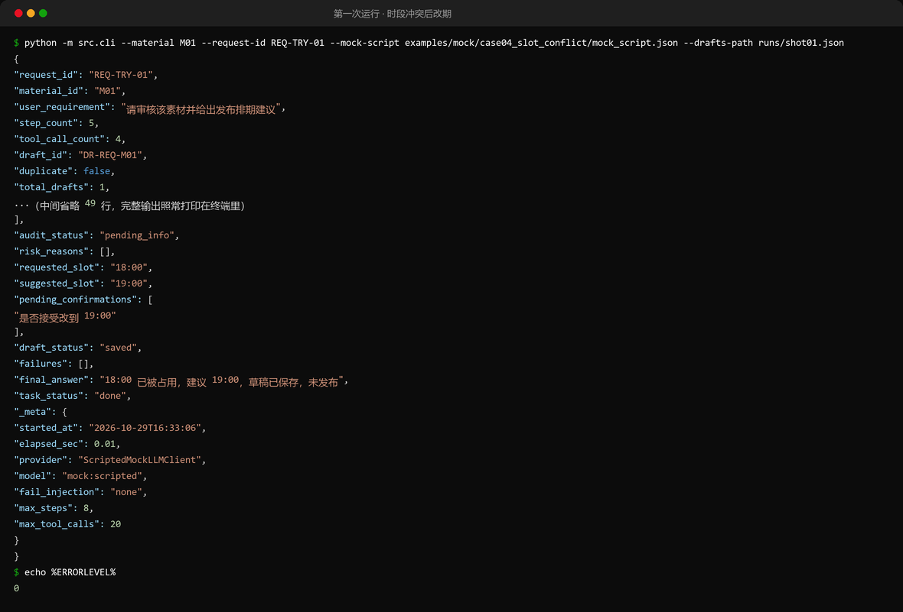
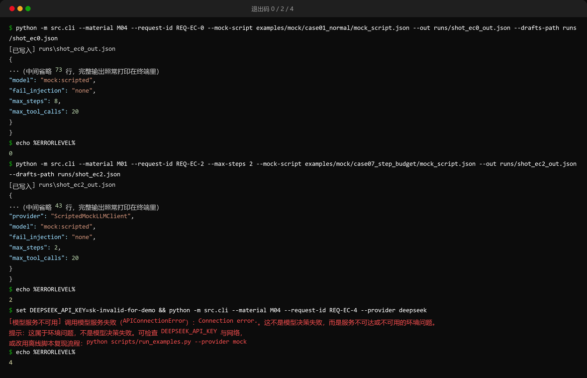
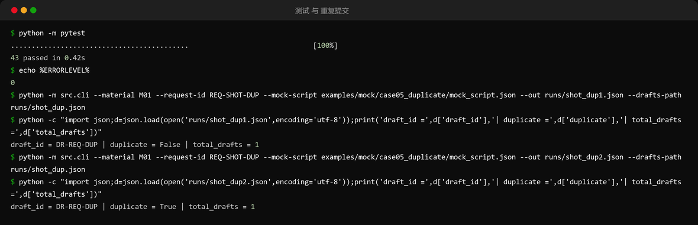
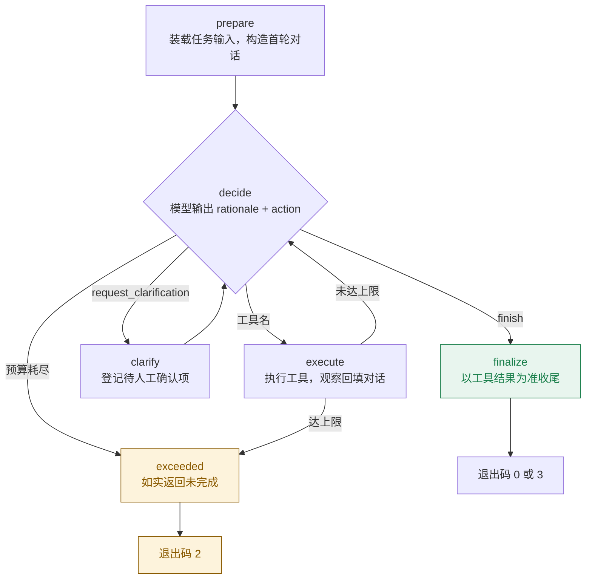
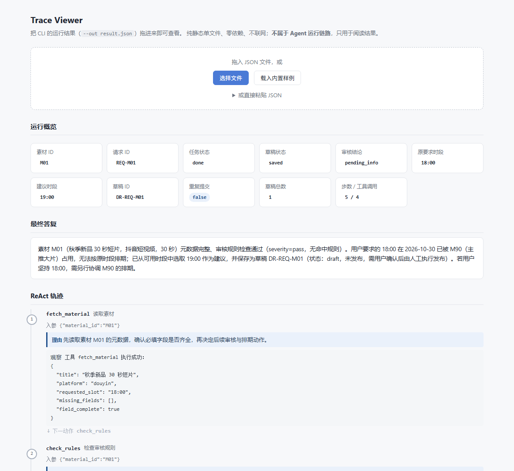
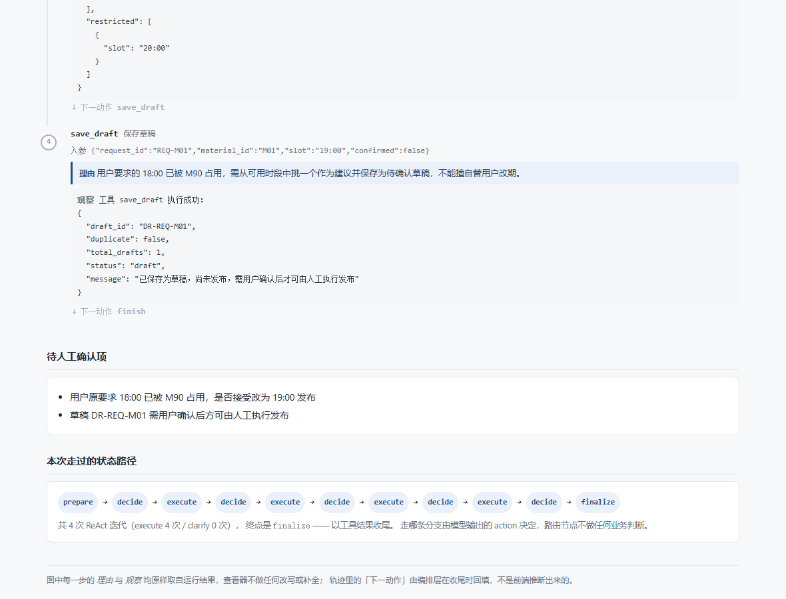

# 素材审核与发布排期 Agent

> **仓库**：https://github.com/a805026135/content-schedule-agent
> **题号**：第 1 题 · 素材审核与发布排期 Agent
> **运行方式**：CLI
> **模型**：`deepseek-flash`（DeepSeek-V4.1-Flash-1017），非思考模式，`temperature=0`
> **编排**：LangGraph `1.2.17`（手写 `StateGraph`，不用 `prebuilt.create_react_agent`）

帮助内容团队找出待处理素材，产出**无冲突、可确认**的发布排期建议。
系统**只能保存草稿，不具备任何发布能力**。

---

## 30 秒跑起来

```bash
python -m venv .venv
.venv/Scripts/python.exe -m pip install -r requirements.txt   # macOS/Linux: .venv/bin/python
cp .env.example .env          # 可选：填入 DEEPSEEK_API_KEY 以使用真实模型
.venv/Scripts/python.exe -m pytest          # 43 个用例，无需任何 Key
.venv/Scripts/python.exe -m src.cli --material M01 --request-id REQ-M01
```

### 运行效果

下面三张图由 `scripts/render_cli_shots.py` **真实执行** CLI / pytest 后渲染生成——
图里每一行（包括退出码）都是真实输出，不是手画的示意图；
跑一遍同一条命令即可得到同样的结果。

第一次运行（离线脚本模式）：M01 想发 18:00，查询时段发现被占用，改建议 19:00，
草稿已保存、留待人工确认：



退出码 0 / 2 / 4 各自的触发方式（`2` = 超预算未完成；`4` = 服务不可用，
用无效 Key 演示——网络不可达时同样报 4，两者都属于环境问题而非决策失败）：



43 个测试不依赖任何 Key；同一 `--request-id` 连跑两次得到同一份草稿
（`duplicate` 从 `false` 变 `true`，`total_drafts` 恒为 1）：



### 没有 Key 时怎么用

`pytest` 的 43 个用例**完全不需要 Key**。CLI 若要离线运行，必须显式给出动作脚本
（离线替身本身不能替模型做决定，所以不存在"什么都不传也能跑"的模式）：

```bash
.venv/Scripts/python.exe -m src.cli --material M01 --request-id REQ-MOCK \
    --mock-script examples/mock/mock_script_example.json

# 单独重放某一条路径（每个用例目录都自带 mock_script.json，自包含）
.venv/Scripts/python.exe -m src.cli --material M01 --request-id REQ-M01 \
    --mock-script examples/mock/case04_slot_conflict/mock_script.json
```

输出的 `_meta.provider` 会写明是 `ScriptedMockLLMClient` / `model=mock:scripted`，
**不会静默假装成真实模型**。更多说明见 `examples/README.md`。

---

## 状态流转



每个节点只做一件事，且只写自己负责的那部分状态：

| 节点 | 做什么 | 写入的关键状态 |
|---|---|---|
| `prepare` | 把静态输入变成首轮对话，只执行一次 | `conversation` |
| `decide` | 调模型取下一步动作；**预算检查在花钱调模型之前** | `step_count`、`_pending_action` |
| `execute` | 按名字取工具并执行，把结果回填进对话 | `trace`、`tool_call_count`、`draft_status` |
| `clarify` | 把待确认项登记下来，不替模型改写问题文案 | `pending_confirmations` |
| `finalize` | 收尾；**保存状态以 trace 为准，不听模型自述** | `draft_status`、`final_answer`、`failures` |
| `exceeded` | 返回明确的未完成状态，草稿状态保持原样 | `task_status=MAX_STEPS_EXCEEDED` |

`finalize` 之后的退出码取决于 `task_status`：正常收尾是 `0`；若模型连续多次给不出合规动作
（`LLM_DECISION_FAILED`）则是 `3`。两条路都经过同一个节点，因为「决策失败」同样要如实收尾、
同样要被记录进 `failures`——它只是不产生排期结论。

两条路由函数**只按 action 名搬运，不做任何业务判断**——是否查询、是否换时段、是否请求确认、
是否结束，全部来自模型的输出。如果把"查到冲突就改期"写成代码里的 `if`，
那就成了固定条件分支，不再是 ReAct。

`finalize` 是这个图里唯一会**纠正模型**的地方，两道防线都在这里：

- trace 里没有任何一次 `save_draft` 成功返回，却声称 `saved` → 强制改写为 `not_saved` 并记入 `failures`；
- 最终答复出现「已发布」类措辞但从未成功保存 → 记一条待人工复核的 `failures`。

---

想先亲手跑一遍再看设计，照抄 `docs/07-quickstart.md`（三种运行模式 + 六个必验点命令 + 退出码复现 + 排障表）。

## 评审入口（建议按这个顺序看）

| 顺序 | 看什么 | 为什么先看它 |
|---|---|---|
| 1 | `docs/01-requirements.md` | 成功标准，后面所有断言都对照它 |
| 2 | `docs/02-solution.md` | 调用流程、**为什么这么设计**（含业界依据与踩坑实录） |
| 3 | `examples/real_llm/README.md` | 六个必验点 + 超限用例的真实运行结论索引 |
| 4 | `examples/real_llm/case04_slot_conflict/trace.md` | 最有代表性的一条：时段冲突后建议替代时段 |
| 5 | `docs/03-evaluation.md` | 测试预期 vs 实际结果、失败用例与已知限制 |
| 6 | `docs/04-ai-usage.md` / `docs/05-retrospective.md` | AI 使用边界与回顾 |
| 7 | `docs/06-submission-note.md` | 可直接粘贴到答题区域的提交说明 |

想跳过文档直接看行为，两条命令：

```bash
.venv/Scripts/python.exe -m pytest                                   # 43 passed
.venv/Scripts/python.exe scripts/run_examples.py                      # 重新生成全部验证材料
```

---

## 退出码是机器可读的接口

| 退出码 | 含义 |
|---|---|
| `0` | 任务完成 |
| `2` | 达到步数或工具调用上限，属于**明确的未完成状态** |
| `3` | 模型连续多次无法给出合规动作（**决策失败**） |
| `4` | 模型服务不可用：网络不可达 / 鉴权失败 / 限流（**环境问题，不是决策问题**） |

```bash
# 不依赖网络即可复现「步数超限 → 退出码 2」
.venv/Scripts/python.exe -m src.cli --material M01 --request-id REQ-M01 --max-steps 2 \
    --mock-script examples/mock/case07_step_budget/mock_script.json ; echo $?   # => 2
```

`3` 与 `4` 分开是有意的：一次网络抖动若被当成"模型给不出合规动作"，
等于把环境问题记到了模型的决策能力账上。

"未完成 ≠ 假装成功"因此是可自动验证的，不依赖人工读文字判断。

---

## 六个必验收点的复现命令

| 验收点 | 命令 | 预期关键点 |
|---|---|---|
| 正常排期 | `--material M04 --request-id REQ-A` | `audit_status=passed`，`suggested_slot=15:00`，`draft_status=saved` |
| 素材信息缺失 | `--material M02 --request-id REQ-B` | 触发 `request_clarification`，`draft_status=not_saved` |
| 规则风险 | `--material M03 --request-id REQ-C` | `audit_status=risky`，`pending_confirmations` 非空 |
| 时段冲突 | `--material M01 --request-id REQ-D` | 18:00 被占 → `suggested_slot=19:00`，且待确认项非空 |
| 重复提交 | 同 `--request-id REQ-E` 连跑两次 | 两次 `draft_id` 相同，`total_drafts=1`，第二次 `duplicate=true` |
| 保存失败 | `--fail-injection save_draft` | `draft_status=not_saved`，`failures` 里 `TOOL_UNAVAILABLE` |

生成好的原始材料在 `examples/real_llm/<用例>/`（`input.json` / `output.json` / `trace.md` / `drafts.json`），
无需重跑即可查阅。离线版本在 `examples/mock/<用例>/`，覆盖同样七条路径。

---

## 测试在守什么

43 个用例分两个文件，**都不需要 API Key**：

| 文件 | 数量 | 验证对象 | 模型怎么来 |
|---|---|---|---|
| `tests/test_tools.py` | 29 | 工具层：没有模型参与时的确定性行为 | 不调用模型 |
| `tests/test_decision_paths.py` | 14 | 编排层：路由、预算、纠正 | `ScriptedMockLLMClient` 脚本替身 |

刻意分开是有原因的：脚本替身只能证明**流程**正确，证明不了**模型会不会做决定**；
所以两者互不充当对方的证据——模型能力的证据放在 `examples/real_llm/`，
流程正确性的证据放在测试里。用脚本替身还顺带解决了 CI 里模型抖动导致用例偶发变红的问题。

### 用例分布

`tests/test_tools.py`（29）

| 分组 | 数量 | 守住什么 |
|---|---|---|
| 结构性防线 | 2 | 工具集无发布入口；写入状态只能是 `draft` |
| `fetch_material` | 4 | 缺失字段如实报缺，不得被"猜"出来 |
| `check_rules` | 5 | 风险分级；**未知算子必须报错而不是静默跳过** |
| `query_slots` | 3 | 数据集里没有的日期不能假装可用 |
| `save_draft` 幂等 | 3 | 同键同体重放、同键异体冲突、不同请求互不干扰 |
| `save_draft` 冲突时段 | 5 | 占用 / 受限 / 已被其他草稿占用 / 未知时段一律拒绝，且失败不留半成品 |
| 故障注入 | 2 | 开关默认关闭；注入后如实返回 `TOOL_UNAVAILABLE` |
| `ToolResult` 不变量 | 5 | `ok` 与 `error_code` 不得并存；**工具文档参数名必须等于函数签名参数名** |

`tests/test_decision_paths.py`（14）

| 分组 | 数量 | 守住什么 |
|---|---|---|
| 两条差异化路径 | 4 | 同一套编排产出两条不同路径；trace 里有理由、有观察、有后续动作 |
| 运行边界 | 3 | 步数 / 工具调用上限；自维护计数器先于 LangGraph 的 `recursion_limit` 生效 |
| 关键缺陷防护 | 7 | 越权发布、虚报保存、隐瞒失败、幻觉工具、重复提交、**网络故障不得算到模型头上** |

### 四个完整用例

下面四段代码可直接从仓库里跑通，每段都附了单跑命令。

**① 发布能力根本不存在**（不是"提示词里写了不要发布"）

```python
# tests/test_tools.py::test_registry_contains_no_publish_capability
def test_registry_contains_no_publish_capability(tools):
    names = set(tools.registry().keys())
    assert names == {"fetch_material", "check_rules", "query_slots", "save_draft"}

    forbidden = ("publish", "post", "release", "commit", "send", "deploy", "push")
    offenders = {n for n in names for f in forbidden if f in n.lower()}
    assert offenders == set()
```

提示词约束可以被绕过和遗忘，工具集里没有这个入口则绕不过去。
```bash
.venv/Scripts/python.exe -m pytest tests/test_tools.py::test_registry_contains_no_publish_capability -v
```

**② 同幂等键配不同内容，必须是冲突而不是重放**

```python
# tests/test_tools.py::test_same_key_different_body_is_a_conflict_not_a_replay
def test_same_key_different_body_is_a_conflict_not_a_replay(tools):
    tools.save_draft(request_id="REQ-CF", material_id="M04", slot="15:00")
    other = tools.save_draft(request_id="REQ-CF", material_id="M01", slot="19:00")
    assert not other.ok
    assert other.error_code == ERR_IDEMPOTENCY_CONFLICT
```

只存 `request_id` 不存内容指纹的实现，会把这第二次请求静默重放成上一次的结果——
那是比报错严重得多的错误，因为它看起来成功了。

**③ 模型声称"已保存"但没保存过，必须被纠正**

```python
# tests/test_decision_paths.py::test_falsely_claimed_save_is_corrected
def test_falsely_claimed_save_is_corrected(isolated_dir):
    script = [
        {"rationale": "读素材", "action": "fetch_material", "action_input": {"material_id": "M04"}},
        {
            "rationale": "直接收尾",
            "action": "finish",
            "action_input": {"answer": "已保存草稿", "draft_status": "saved"},
        },
    ]
    path = _run(_agent(script, isolated_dir=isolated_dir))
    assert path["draft_status"] == "not_saved"
    assert any("强制记为未保存" in f["reason"] for f in path["failures"])
```

输入脚本里模型明确写了 `draft_status: "saved"`，但 trace 里一次成功的 `save_draft` 都没有。
`finalize` 以工具结果为准改写状态，模型自述不作数——这条直接对应"虚报保存成功"这个关键缺陷。

**④ 达到上限必须返回明确的未完成状态**

```python
# tests/test_decision_paths.py::test_step_budget_returns_explicit_unfinished_state
def test_step_budget_returns_explicit_unfinished_state(isolated_dir):
    looping = [
        {"rationale": "反复重试", "action": "query_slots", "action_input": {}}
        for _ in range(50)
    ]
    path = _run(_agent(looping, isolated_dir=isolated_dir, max_steps=3))
    assert path["task_status"] == STATUS_EXCEEDED
    assert path["draft_status"] == "not_saved"
    assert "未完成" in path["final_answer"]
    assert path["step_count"] <= 4
```

脚本给了 50 步，预算只有 3 步。断言的最后一行为什么是 `<= 4` 而不是 `== 3`：
预算检查发生在**调用模型之前**，所以第 4 步不会真的花钱去问模型，只是被判超限。
```bash
.venv/Scripts/python.exe -m pytest tests/test_decision_paths.py::test_step_budget_returns_explicit_unfinished_state -v
```

还有一个值得单独看的用例
`tests/test_decision_paths.py::test_model_unavailable_is_not_reported_as_decision_failure`：
它锁定的是"网络不可达必须报成服务不可用（退出码 4），不能被算成模型给不出合规动作（退出码 3）"——
一次网络抖动如果被记到模型的决策能力账上，失败归因就脏了。

---

## 用查看器阅读运行结果（可选）

`viewer/index.html` 是一个**零依赖单文件**页面，用来读 CLI 的输出：

```bash
# 1. 让 CLI 把结果落成 JSON
.venv/Scripts/python.exe -m src.cli --material M01 --request-id REQ-M01 \
    --mock-script examples/mock/case04_slot_conflict/mock_script.json \
    --out runs/demo.json --drafts-path runs/demo-drafts.json

# 2. 用浏览器打开 viewer/index.html，把 runs/demo.json 拖进去
#    不想先跑命令：直接打开 viewer/index.html?sample=1 看内置样例
```

页面会渲染：概览卡片（任务/草稿/审核状态、建议时段、是否重复）、最终答复、
ReAct 轨迹（每一步的**理由 / 入参 / 观察 / 下一动作**）、规则风险原因、待人工确认项、
失败与纠正记录、以及本次实际走过的状态路径。

下面两张图是 headless Chrome 打开 `viewer/index.html?sample=1` 的**真实截图**
（页面渲染的就是那条真实运行输出，不是另外画的效果图）：



每一步的理由、入参、观察都原样取自运行结果的 trace，观察里的 JSON 被拆出来缩进排版；
「下一动作」是编排层在收尾时回填的字段，不是前端推断出来的。



底部的状态路径按真实顺序展开 `prepare → decide → execute → …`，
终点若是 `exceeded`（超预算未完成）会用另一种颜色标出。

三点需要说明：

- 它**不在运行链路里**，不进 `requirements.txt`，不改动任何 Agent 行为，纯属阅读辅助；
- 轨迹里的每一项都原样取自运行结果，页面不做补全、不做改写，也不推断分支；
- 支持拖入文件 / 选择文件 / 粘贴 JSON 三种方式，`file://` 直接双击打开即可，不需要起服务。

---

## 项目结构

```
content-schedule-agent/
├── src/
│   ├── cli.py                    CLI 入口，含退出码语义
│   ├── config.py                 环境变量 -> Settings，含故障注入开关
│   ├── agent/
│   │   ├── graph.py              ReAct 状态机（本项目的核心）
│   │   ├── llm.py                真实模型 / 离线 Mock 双入口 + 输出契约
│   │   ├── prompts.py            系统提示词（工具签名从代码生成）
│   │   └── state.py              State 与 trace 记录的 schema
│   └── tools/
│       └── schedule_tools.py     四个确定性工具 + 幂等写 + 故障注入
├── tests/                        43 个用例（工具层 29 + 编排层 14），均无需 Key
├── examples/
│   ├── real_llm/                 真实模型跑出来的六组 + 超限用例（决策能力的证据）
│   └── mock/                     离线脚本跑出来的七组，零配置复现（流程的证据）
├── data/                         合成素材、规则、排期表
├── viewer/
│   └── index.html               单文件结果查看器（可选展示层，零依赖，不进依赖清单）
├── docs/                         01 ~ 07
└── scripts/                      接入自检、决策探针、示例生成、运行截图渲染
```

---

## 一句话总结设计取向

> 冲突调整、确认边界、防重复这三条要求**全部可以用结构性手段保证**，
> 所以本项目把它们做进代码而不是写进提示词：工具集里没有 `publish`、
> `request_id` + 指纹做幂等、保存状态以工具结果为准。
> 模型只负责它不可替代的那一部分 —— 根据观察选择下一步动作。

---

## 已知限制

- 规则引擎是字符串/相等判定级别的玩具实现，"最强"换个同义表述就测不出来。
- 草稿不会自动落到任何真实发布系统；本仓库**刻意不提供发布能力**。
- 已有草稿不回填 `schedule.json`，跨素材冲突只在同一份草稿存储内检测。
- 详见 `docs/03-evaluation.md` 的「已知限制」一节。
